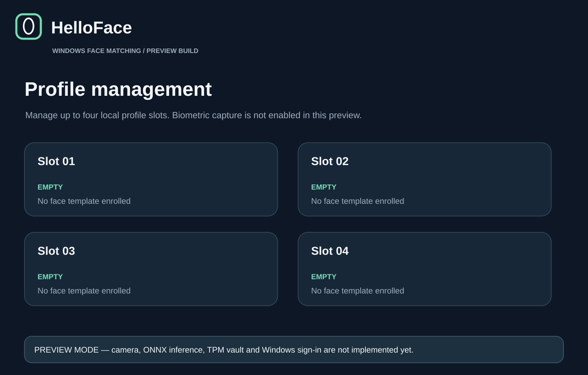

# HelloFace

<div align="center">
  
  <h3>Private, local-first face matching for Windows</h3>
  <p>C++20 · CMake · Windows 10/11 · ONNX Runtime (planned)</p>
</div>

> **Experimental preview — not a Windows Hello replacement.** This setup installs a profile-management UI preview only. It does not capture faces, recognize users, unlock Windows, install a Credential Provider or replace PIN/password sign-in. RGB webcam matching is vulnerable to sophisticated presentation attacks.

## Screenshots

These are screenshots/mockups of the actual preview UI design. They are not evidence of a working biometric engine.



## Downloads

- **Windows setup:** [Download the latest HelloFace-Setup.exe](https://github.com/mrcuriousmind3-web/HelloFace/releases/latest/download/HelloFace-Setup.exe) (available after the first versioned release is published).
- **Explainer video:** [Download HelloFace-Explainer.mp4](https://github.com/mrcuriousmind3-web/HelloFace/releases/latest/download/HelloFace-Explainer.mp4) (available after the first versioned release is published).
- **Latest CI artifacts:** [Open GitHub Actions](https://github.com/mrcuriousmind3-web/HelloFace/actions). Open the latest successful Windows Preview Build and download the `HelloFace-Windows-Preview` artifact.

The installer and MP4 are generated by GitHub Actions on Windows. No executable is committed as source. Release assets are published when a `v*` tag is pushed.

## Current status

The repository contains a native Windows preview dashboard, a bounded four-slot IPC protocol and tests, CI packaging, an explainer-video renderer, security/recovery documentation and a consistent logo.

It does **not** yet contain a working Credential Provider, camera service, ONNX models, enrollment/capture pipeline, TPM vault, or automatic Windows sign-in flow. Do not treat the preview as an authentication product.

## Design goals

- Four independently managed face-template slots.
- Local inference; no cloud upload of face images or embeddings.
- Camera and model inference outside the Credential Provider DLL.
- Strictly bounded IPC, explicit pipe ACLs, client PID/session/signer validation, replay protection.
- TPM-backed key protection and authenticated encryption for templates.
- Built-in Windows password/PIN providers remain available.
- Explicit enrollment consent, per-slot deletion, and recoverable uninstall.

## Security architecture decisions

A Credential Provider supplies a credential serialization to Windows; it does not create a Windows logon token itself. Storing reusable Windows passwords for later decryption inside LogonUI would create a high-impact credential-theft target. HelloFace will not put reusable account passwords or Windows Hello PINs in its biometric vault.

A SYSTEM service runs in Session 0 and cannot be assumed to access the interactive webcam. A session-aware capture design and physical-device validation are required before lock-screen integration. RGB PAD cannot offer the assurance of dedicated IR/depth hardware.

See [implementation plan](docs/IMPLEMENTATION_PLAN.md), [security policy](SECURITY.md), [privacy](PRIVACY.md), and [recovery guide](RECOVERY.md).

## Build the preview from source

Requirements: Visual Studio 2022 C++ workload, CMake 3.24+, and Inno Setup 6 to package.

```powershell
cmake -S . -B build -A x64
cmake --build build --config Release
ctest --test-dir build -C Release --output-on-failure
```

The Windows CI workflow builds the native preview app, packages Setup.exe, renders the MP4 explainer and uploads both as an Actions artifact. The Credential Provider option remains disabled.

## Reference and attribution

Architecture inspiration: [nyxri0f8/winface](https://github.com/nyxri0f8/winface). HelloFace is a separate project; no WinFace source code or model assets are copied into this repository. Third-party model and runtime licences will be documented before dependencies are bundled.

## Branding

The HelloFace mark is in `assets/helloface-mark.svg`. Use this same mark in the configuration app, installer, documentation and release artwork.

## Contributions

Please report security issues privately through GitHub Security Advisories. Do not submit real face images, passwords, biometric templates or personal account data in issues.
